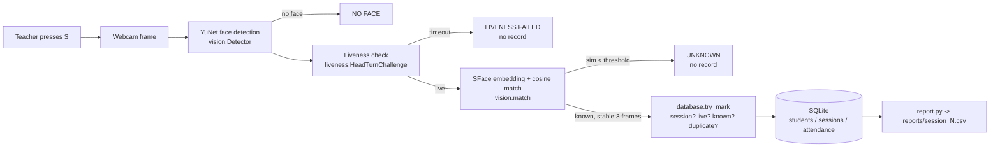

# Architecture

| Stage | Module | Status | Owner |
|---|---|---|---|
| Webcam + teacher controls | `main.py` | implemented | Parth |
| Face detection (YuNet, pretrained) | `vision.py` | implemented | Faraz |
| Face recognition (SFace, pretrained, cosine sim) | `vision.py` | implemented | Faraz |
| Liveness, head-turn heuristic | `liveness.py` | simplified / preliminary | Vibhuti |
| Liveness, CNN anti-spoofing (transfer learning) | `liveness.py` (`check()` slot) | **pending** | Vibhuti |
| Enrollment | `enroll.py` | implemented | Vaishali |
| Database + duplicate prevention | `database.py` | implemented | Vaishali |
| CSV report | `report.py` | implemented | Vaishali |
| Recognition evaluation | `evaluate.py` | implemented, awaiting test data | Faraz / Vibhuti |

The attendance write path has exactly one gate, `database.try_mark`. It refuses to write a record
when there is no session, when liveness failed, or when the face is Unknown. A `UNIQUE(session_id, student_id)`
constraint blocks duplicates.
